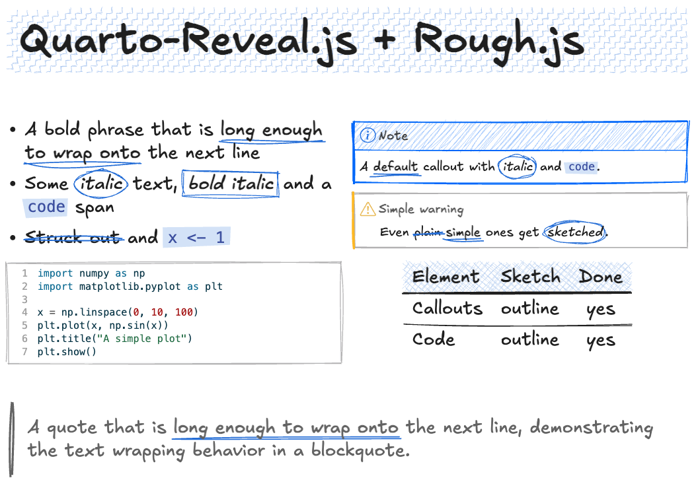

# qrough

A Quarto extension for **hand-drawn revealjs presentations**. Write your
slides as usual and qrough gives them a sketchy, Excalidraw-style look, as if
the deck had been drawn on a whiteboard.

qrough adds no new syntax. It takes the elements Quarto already produces and
redraws their borders, fills and highlights in the browser with
[rough.js](https://roughjs.com), so any existing deck can switch to it by
changing a single line of front matter, and switch back just as easily.

qrough supports revealjs only. Other formats are left untouched, and HTML
documents get a render warning.

## Example



The slide above (shown after the deck's title slide) is rendered from
[`example.qmd`](example.qmd):

```markdown
---
title: "qRough"
subtitle: "A Quarto-Reveal.js format for hand-drawn slides, powered by Rough.js"
format:
  qrough-revealjs:
    mainfont: Excalifont   # any installed font; qrough does not set fonts
    qrough:
      roughness: 2         # how sketchy the lines are (0 = straight)
      seed: 42             # base seed; fixed so shapes don't jitter on redraw
---

## Quarto-Reveal.js + Rough.js {.smaller}

<br />

:::: {.columns}
::: {.column width="55%"}
- A bold phrase that is **long enough to wrap onto** the next line
- Some *italic* text, ***bold italic*** and a `code` span
- ~~Struck out~~ and `x <- 1`
:::

::: {.column width="45%"}
::: {.callout-note title="Note"}
A **default** callout with *italic* and `code`.
:::

::: {.callout-warning appearance="simple"}
## Simple warning
Even ~~plain~~ **simple** ones get *sketched*.
:::
:::
::::
```

## What gets sketched

- [x] **Slide titles**: a hand-drawn band behind each `##` title, in the
      theme's accent colour
- [x] **Callouts**: all types and `default`/`simple`/`minimal` appearances,
      including nested callouts and callouts in columns and fragments
- [x] **Inline code**: a light highlight
- [x] **Italic**: circled
- [x] **Bold**: underlined
- [x] **Bold italic**: boxed
- [x] **Strikethrough**: a rough line across the text
- [ ] Code blocks
- [ ] Tables
- [ ] Figures

Inline marks follow the text when it wraps onto several lines.

## Install

```bash
quarto add dasayan05/qrough
```

Or start a new deck from the bundled template:

```bash
quarto use template dasayan05/qrough
```

### Font

qrough does not set or ship any font. For the full Excalidraw look, install
[Excalifont](https://plus.excalidraw.com/excalifont) on your system and set it
with Quarto's own `mainfont` option in your deck's front matter:

```yaml
format:
  qrough-revealjs:
    mainfont: Excalifont
```

`mainfont` only names the font; it does not embed it in the rendered deck.
The font has to be installed on the computer that *views* the deck, not just
the one that renders it. That is fine when you present from your own laptop,
but anyone else who opens the HTML (a shared link, a published deck, a
colleague's machine) without Excalifont installed sees the browser's default
font instead, usually a serif such as Times. The rough.js drawings still
appear; only the lettering changes.

To give a fallback, list several fonts. The browser uses the first one it
has:

```yaml
format:
  qrough-revealjs:
    mainfont: "Excalifont, 'Comic Sans MS', cursive"
```

To make the font travel with the deck, serve it as a web font instead: put
the font file next to your deck and load it with an `@font-face` rule in a
custom CSS file (`css: fonts.css`). Check the font's licence before you
publish its file.

## Use

```yaml
format: qrough-revealjs
```

`qrough-revealjs` is regular `revealjs` with the qrough filter and plugin
switched on, so every revealjs option still works under it:

```yaml
format:
  qrough-revealjs:
    slide-number: true
    qrough:
      roughness: 1.5
```

Under the hood the format runs a filter that injects the assets and your
options, and a plugin that redraws slides as Reveal shows them, as well as in
overview and `?print-pdf` mode.

## Options

Every supported element is restyled; the look of each one is fixed by qrough.
Only two options can be set, under `qrough:`, either nested in the format (as
above) or at the top level of the document:

```yaml
qrough:
  roughness: 1.2       # how sketchy the lines are (default 1, 0 = straight)
  seed: 42             # base seed; fixed so shapes do not jitter on redraw
```

Colours come from the active reveal theme. Without JavaScript the deck falls
back to Quarto's normal styling.

## Development

`example.qmd` is the test deck. It picks up the extension from the
neighbouring `_extensions/` folder, so you can edit and preview in place:

```bash
quarto preview example.qmd
```

## Credits

- rough.js © Preet Shihn, MIT licence (`assets/LICENSE-roughjs`).
